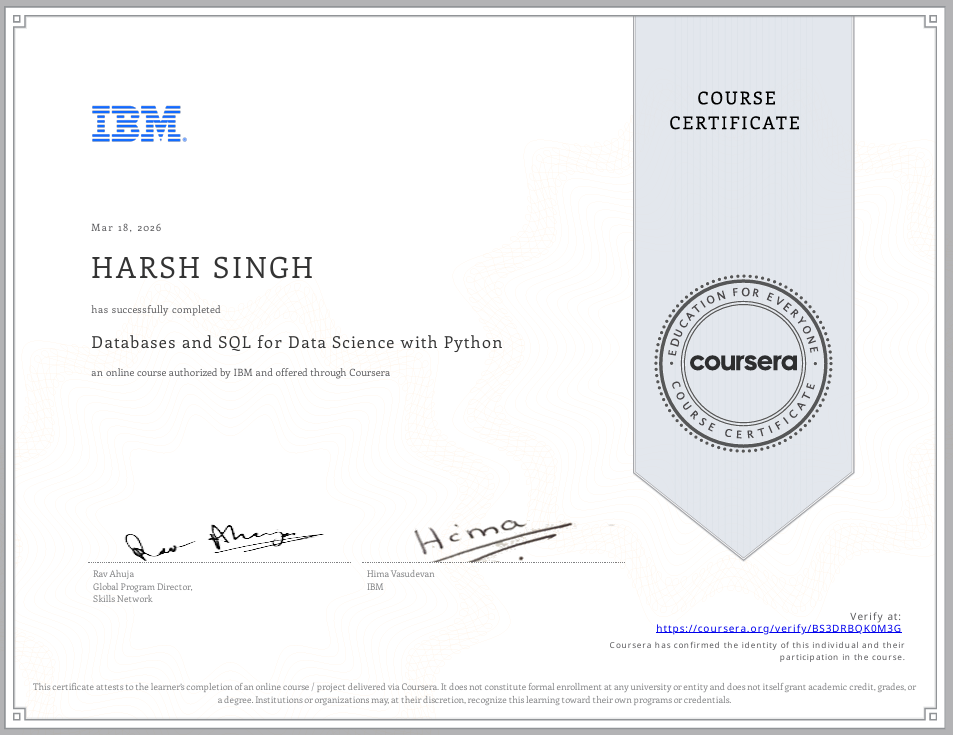
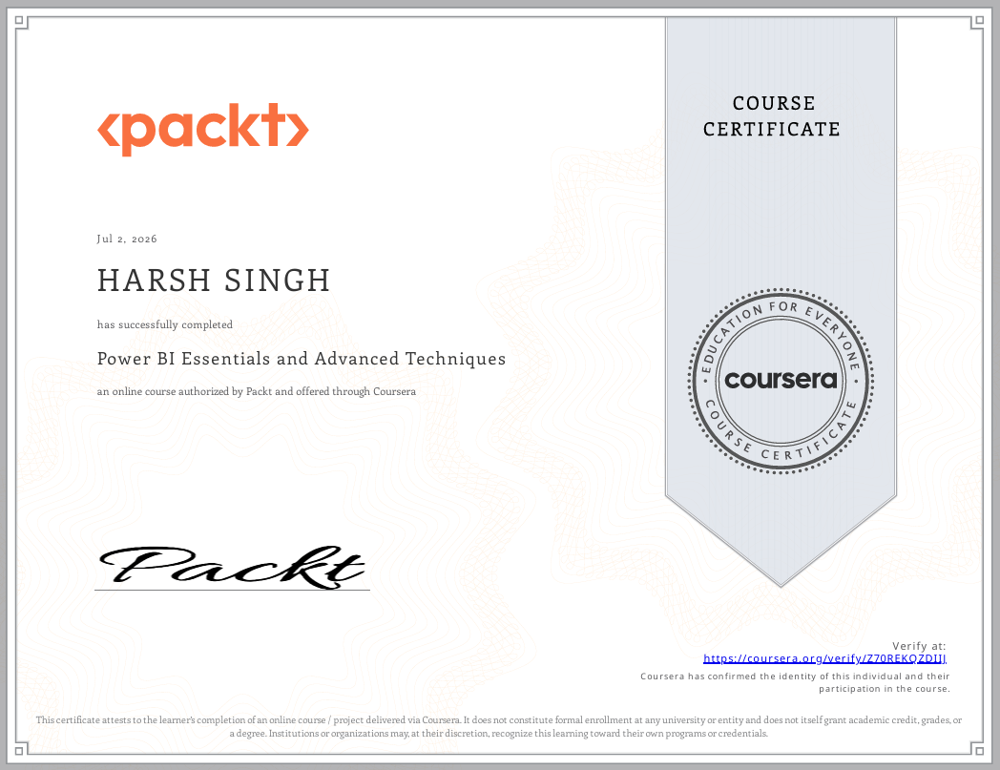

# Professional-Certificates
A collection of my professional certifications in Data Analytics, Business Analytics, and related technologies.

Hi! I'm **Harsh Singh**, a BBA Business Analytics student.

This repository contains my verified professional certifications in Data Analytics, Business Analytics, SQL, Power BI, Excel, Python, and more.

---

## 🏆 Certificates

### 1. IBM - Databases and SQL for Data Science with Python

📄 [View Certificate PDF](SQL/IBM_SQL.pdf)

---

### 2. Packt - Power BI Essentials and Advanced Techniques

📄 [View Certificate PDF](PowerBI/PowerBI_Packt.pdf)

---

### 3. Microsoft - Power BI Fundamentals and Data Modeling

![Power BI].("C:\Users\harsh\OneDrive\Pictures\Screenshots\PowerBI_Microsoft.png")

[View Certificate PDF].("C:\Users\harsh\Downloads\Power bi Fundamentals and Data Modeling Certificate.pdf")

⭐ More certificates will be added as I continue learning.
